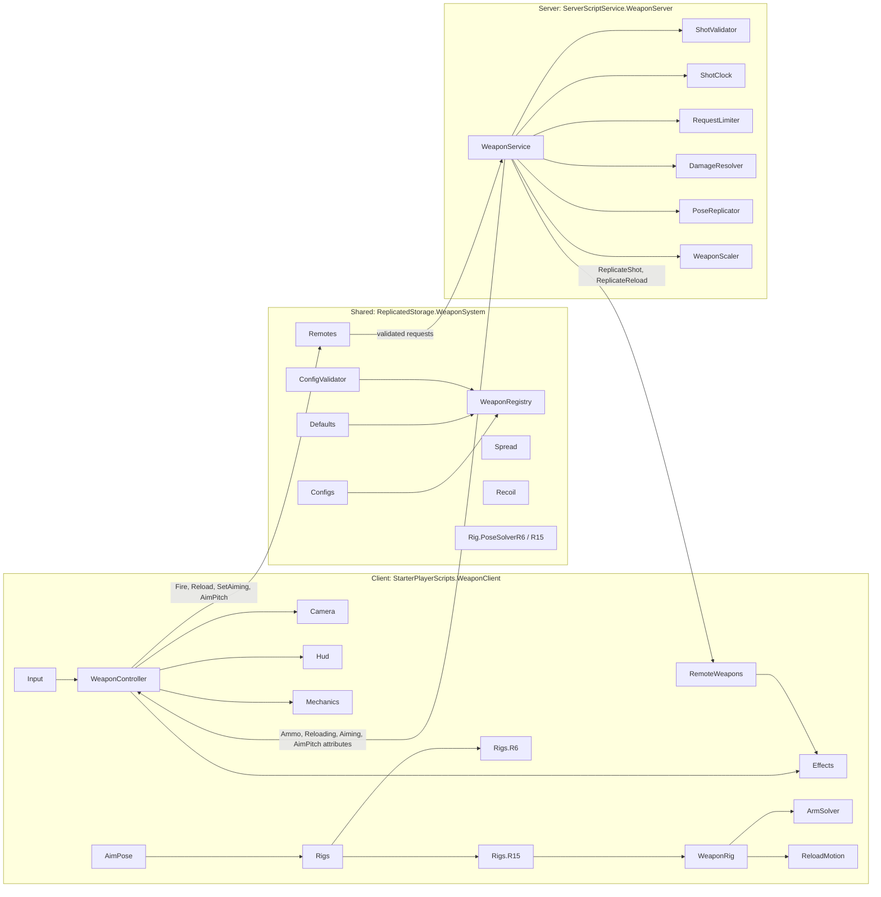

# Roblox Weapon System

[](https://github.com/codext4fn-afk/roblox-gun-system/actions/workflows/ci.yml)

A server-authoritative, data-driven firearm system for Roblox, written in strict Luau and built with Rojo. One codebase drives both R6 and R15 characters: hitscan shooting with client prediction, procedural recoil and sway, two-bone arm IK on R15, per-weapon reload choreography, and pooled visual effects. Adding a weapon is a new config file and a Tool model, with no code changes.


> Demo GIF placeholder: record a short clip of ADS, full-auto fire, a reload and a TRex scope shot, and save it as `docs/demo.gif`.

## Features

- **Server-authoritative shooting.** The client predicts and renders; the server validates every shot before it deals damage (see [Server validation](#server-validation)).
- **Data-driven weapons.** Six weapons ship as plain config modules over a shared `Defaults` table, validated at load time against an exported `WeaponConfig` type.
- **R6 and R15 from one system.** Rig-specific behaviour lives in two small adapters; everything else is shared.
- **First- and third-person play.** Over-the-shoulder ADS with a swappable shoulder, first-person sights with FOV-matched sensitivity, and a full-screen scope overlay for solid optics.
- **Procedural feel.** Camera recoil and shake, weapon kick, walk bob, idle sway, turn and look sway on fixed-step springs, sprint carry, wall obstruction and draw.
- **R15 arm IK.** Analytic two-bone IK keeps both hands on the weapon at any pitch, with shoulder protraction and forearm twist.
- **Reload choreography.** Straight, rock-in and bolt-feed reloads, chest or hip pouches, magazine taps and charging-handle racks, all timed from config.
- **Pooled effects.** Tracers, muzzle flashes, impact particles by surface material, bullet holes and shell casings reuse a fixed pool.
- **Keyboard, gamepad and touch.** Bindings are data in `Settings.Controls`; touch buttons are created automatically on mobile.
- **Tooling.** Rojo, rokit-pinned toolchain, StyLua, selene, luau-lsp strict type checking, Lune unit tests and GitHub Actions CI.

## Architecture



**Flow of a shot.** `WeaponController` raycasts from the camera to find the aim point, samples pellet directions with `Spread`, fires the `Fire` remote and immediately plays the shot locally (tracer, flash, casing, recoil, hitmarker). `WeaponService` validates the request, decrements ammo, raycasts each accepted pellet itself and applies damage through `DamageResolver`, then sends the server's hit positions to nearby players, whose `RemoteWeapons` draws the tracers.

**State.** Ammo and reload state are owned by the server as attributes on the Tool. Aim state and aim pitch are attributes on the character, which the server uses to pose the upper body for everyone and other clients use to pose arms.

## Server validation

Every remote argument is treated as untrusted. A `Fire` request is dropped unless all of these hold:

| Check | Rule |
|---|---|
| Argument types | Origin is a finite `Vector3`; aim is a finite direction longer than 0.5; pellets are a plain array of 1 to `Pellets` entries with no extra keys. NaN and infinity are rejected. |
| Ownership | The tool is a registered weapon, parented to the shooter's own living character. |
| Aim state | The character is aiming (or the player's latest aim request says so, which closes the race between aiming and the first shot). |
| Reload state | The tool is not reloading. |
| Ammo | The tool has at least one round. |
| Origin | The shot origin is within `MaxOriginOffset` (6 studs) of the shooter's head. |
| Line of sight | Nothing solid lies between the head and the claimed origin, so shots cannot start behind a wall. |
| Fire rate | A per-tool `ShotClock` budget refills at exactly `1 / FireInterval` and caps at `FireRateBurst` (1.15). It allows the same 15 % network jitter as before but makes sustained fire faster than the weapon's rate impossible. |
| Spread | Each pellet must lie within `HipSpread + SpreadTolerance` degrees of the aim direction; pellets outside it are discarded. |
| Range | The server raycasts each pellet itself to the weapon's `Range`; client hit positions are never trusted. |

`Reload`, `SetAiming` and `AimPitch` are rate limited per player by `RequestLimiter`. Aim requests that arrive too quickly are coalesced into a single deferred update instead of spawning a thread each. Pitch is clamped to ±80°. Team and neutral rules decide whether damage applies, and a `creator` tag is placed on the victim for kill credit.

**Known limit.** The client chooses the pellet directions within the allowed cone, so a modified client can always shoot at the centre of its spread. A server-issued spread seed was considered, but a client that knows the seed can burn unwanted patterns with deliberately rejected requests, so it would not close the gap. Hitscan systems that keep client-side prediction share this trade-off; the cone check bounds it.

## Adding a new weapon

No code changes are needed. A weapon is a config module plus a Tool, matched by name.

1. **Tool.** Add `assets/Weapons/<Id>.model.json` (or put the Tool in StarterPack in Studio). The Tool needs a `Handle` part and these attachments inside `Handle`:

   | Attachment | Required | Purpose |
   |---|---|---|
   | `Muzzle` | yes | Barrel tip; its dominant axis is the weapon's forward axis. |
   | `AimPoint` | for ADS | Behind the rear sight, on the sight line. The first-person camera sits here when zoomed. |
   | `ShootFirst` | for ADS | Front sight, same height as `AimPoint`. Used to align the gun with the crosshair. |
   | `SupportGrip` | R15 | Where the support hand holds. Set attribute `VerticalGrip = true` for a vertical foregrip. |
   | `Ejection` | optional | Ejection port for casings. |
   | `MagazineWell` | optional | For weapons whose magazine is part of the body mesh; set a `MagazineLength` attribute. |

   Sounds named `Fire`, `Reload`, `Empty`, `MagOut` and `MagIn` in `Handle` are played when present. Moving parts named by `Bolt.Part` and `Magazine.Part` need a `Motor6D` named `GunJoint` to the Handle. Running `require(game.ServerStorage.WeaponEditor.GunSetup).Build(tool)` in the Studio command bar welds everything and creates those joints, and `GunSetup.Validate(tool)` lists anything missing.

2. **Config.** Add `src/shared/Configs/<Id>.luau`. Anything left out falls back to `Defaults`. Unknown keys produce a warning, and a config that fails validation is not registered.

```luau
--!strict
local Types = require(script.Parent.Parent.Types)

local config: Types.WeaponOverrides = {
	Mode = "Auto",
	FireInterval = 60 / 700,
	Damage = { Head = 50, Torso = 26, Limb = 17 },
	FriendlyFire = false,
	Pellets = 1,
	Range = 750,
	MagSize = 30,
	ReloadTime = 2.3,
	HipSpread = 2.4,
	AimSpread = 0.35,
	AimFOV = 50,
	FirstPersonFOV = 60,
	ScopeFOV = 38,
	ScopeOverlay = false,
	AimSensitivity = 1,
	ShowCrosshair = true,
	FirstPersonPushR6 = 0,
	EyeOffset = Vector3.new(0, 0, 0),
	AimWalkSpeed = 10,
	Recoil = 0.32,
	AimRecoilMultiplier = 0.6,
	CameraShake = 0.3,
	ArmKick = 0.55,
	EjectCasings = true,
	CasingSize = Vector3.new(0.16, 0.055, 0.055),
	CasingColor = Color3.fromRGB(201, 164, 76),
	Bolt = { Part = "Bolt", Travel = 0.35, OutTime = 0.03, ReturnTime = 0.07 },
	Magazine = {
		Part = "Magazine",
		Hand = "Left Arm",
		GripAttachment = "LeftGripAttachment",
		HoldOffset = CFrame.new(),
		UseMarkers = false,
		Out = 0.08,
		Drop = 0.3,
		Grab = 0.45,
		In = 0.6,
		InsertDepth = 0.35,
		SlideTime = 0.08,
		AttachTime = 0.12,
		AlignTime = 0.14,
		SeatTime = 0.07,
		SeatKick = 0.25,
		DropLifetime = 6,
	},
	Reload = { Style = "Straight", Pouch = "Chest", Tap = true, Rack = "Empty", Prop = "" },
	Animations = {
		R6 = { Hold = "", Aim = "", Fire = "", Reload = "rbxassetid://0000000000" },
		R15 = { Hold = "", Aim = "", Fire = "", Reload = "" },
	},
	Handling = {
		FirstPersonGrip = Vector3.new(0.235, -0.81, -0.51),
		FirstPersonHip = CFrame.Angles(0, math.rad(2.5), 0),
		LowReady = CFrame.new(0.35, 0.2, -0.5) * CFrame.Angles(math.rad(-35), math.rad(22), math.rad(-12)),
		DrawnDown = CFrame.new(0.15, -0.8, 0.45) * CFrame.Angles(math.rad(-55), math.rad(25), math.rad(-25)),
		DrawTime = 0.35,
		ReloadTilt = CFrame.new(-0.06, 0.04, 0.1) * CFrame.Angles(math.rad(10), math.rad(12), math.rad(-32)),
		SprintCarry = CFrame.new(-0.3, -0.62, -0.25) * CFrame.Angles(math.rad(42), math.rad(16), math.rad(14)),
		ReloadUsesAnimation = false,
	},
}

return config
```

### Config reference

| Field | Meaning |
|---|---|
| `Mode` | `"Auto"` fires while the trigger is held; `"Semi"` fires once per press. |
| `FireInterval` | Seconds between shots. `60 / rpm` reads well. |
| `Damage` | Damage per pellet by hit zone. Head is `Head`; Torso is `Torso`, `UpperTorso`, `LowerTorso` and `HumanoidRootPart`; everything else is `Limb`. A part can override its zone with a `BodyPart` attribute (for helmets or gloves). |
| `Pellets` | Pellets per shot, each sampled uniformly over the spread cone. |
| `HipSpread`, `AimSpread` | Cone half-angle in degrees, blended by how far the player is zoomed. |
| `AimFOV`, `FirstPersonFOV`, `ScopeFOV` | Third-person ADS FOV, first-person hip FOV, and first-person ADS FOV. |
| `ScopeOverlay` | Draws a full-screen scope when fully zoomed in first person, for optics with a solid lens mesh. |
| `AimSensitivity` | Extra mouse sensitivity multiplier when zoomed, on top of the automatic FOV-matched reduction. |
| `FirstPersonPushR6` | Studs the weapon slides forward in the local R6 first-person view, for long weapons. Other players see the normal hold. |
| `EyeOffset` | Eye relief behind the eyepiece in camera space (+Z is back). |
| `Recoil`, `AimRecoilMultiplier` | Camera kick in degrees per shot, scaled by the multiplier. |
| `CameraShake`, `ArmKick` | First-person shake and weapon kick strength. |
| `Bolt` | The part that cycles on each shot, how far it travels and how fast. |
| `Magazine` | The magazine part and the reload timeline as fractions of `ReloadTime` (`Out`, `Drop`, `Grab`, `In`, in order). `UseMarkers` drives the R6 reload from `MagOut`, `MagDrop`, `MagGrab` and `MagIn` animation markers instead. |
| `Reload.Style` | `"Straight"` pulls the magazine straight out, `"RockIn"` tips it off a front hook, `"BoltFeed"` opens the bolt and feeds rounds at the port. |
| `Reload.Pouch`, `Tap`, `Rack` | Where the fresh magazine comes from, whether it is slapped home, and when the charging handle is worked (`"Never"`, `"Empty"`, `"Always"`). |
| `Reload.Prop` | For magazines that are part of the body mesh: the name of a stand-in in `WeaponSystem.Props` shown in the hand. |
| `Animations` | Published animation ids per rig. See [Animations](#animations). |
| `Handling` | R15 carry poses as offsets on the weapon's eye frame: first-person hip, low ready, drawn-down start, reload tilt and sprint carry. `ReloadUsesAnimation = true` hands the arms to a hand-made reload animation instead of the IK. |

### Animations

For each weapon, rig and animation (`Hold`, `Aim`, `Fire`, `Reload`) the first match wins:

1. The published id in the weapon's `Animations.<Rig>.<Name>`.
2. A draft `KeyframeSequence` at `WeaponSystem.AnimationDrafts.<Rig>.<WeaponId>.<Name>` (Studio only).
3. The shared id in `Settings.SharedAnimations.<Rig>.<Name>`.
4. A shared draft at `WeaponSystem.AnimationDrafts.<Rig>.<Name>` (Studio only).

Drafts only play inside Studio, so live servers need published ids. `WeaponEditor.WeaponAnimationBuilder.Build("<Id>")` generates per-weapon drafts from a weapon's geometry and config, ready to edit and publish. R15 arms are always solved by IK unless `ReloadUsesAnimation` is set, so R15 animations only need to carry the body.

## Setup

Requirements: [Roblox Studio](https://create.roblox.com/) and [rokit](https://github.com/rojo-rbx/rokit).

```bash
git clone https://github.com/codext4fn-afk/roblox-gun-system.git
cd roblox-gun-system
rokit install
```

Build a place and open it in Studio. Mesh ids cannot be live-synced by Rojo, so the Tools come from the build:

```bash
rojo build -o WeaponSystem.rbxl
```

Then live-sync code changes with the Rojo plugin (`rojo plugin install` once, then Plugins → Rojo → Connect):

```bash
rojo serve
```

Choose R6 or R15 under Game Settings → Avatar. Test → Clients and Servers with two players shows damage and what other players see.

Checks, as run in CI:

```bash
stylua --check src tests
selene src
rojo sourcemap default.project.json -o sourcemap.json
luau-lsp analyze --platform roblox --sourcemap sourcemap.json --definitions "@roblox=globalTypes.d.luau" src
lune run tests/run.luau
```

`globalTypes.d.luau` comes from the [luau-lsp repository](https://github.com/JohnnyMorganz/luau-lsp/tree/main/scripts) at the pinned version.

## Controls

| Action | Keyboard and mouse | Gamepad | Touch |
|---|---|---|---|
| Fire | Left mouse | R2 | Fire button (hold) |
| Aim down sights | Right mouse (hold) | L2 (hold) | Aim button (toggle) |
| Reload | R | X | Reload button |
| Switch shoulder | Q | D-pad right | Swap button |

Firing requires aiming in third person; in first person the weapon is always ready. Bindings and touch button positions are in `Settings.Controls` and `Settings.Touch`.

## Project structure

```
.
├── default.project.json        Rojo tree
├── rokit.toml                  pinned rojo, stylua, selene, lune, luau-lsp
├── assets/
│   ├── GunHUD.model.json       HUD layout
│   ├── Props/                  reload stand-ins
│   └── Weapons/                the six Tools, asset ids only
├── src/
│   ├── shared/                 ReplicatedStorage.WeaponSystem
│   │   ├── Types.luau          WeaponConfig and related types
│   │   ├── Defaults.luau       every setting a weapon can override
│   │   ├── Settings.luau       system-wide tuning, controls, shared animations
│   │   ├── Configs/            one module per weapon
│   │   ├── ConfigMerge.luau    ConfigValidator.luau  WeaponRegistry.luau
│   │   ├── Spread.luau         Recoil.luau  Spring.luau  AngleMath.luau
│   │   ├── Raycast.luau        WeaponAxes.luau  HitZones.luau  WeaponAnimations.luau
│   │   ├── Remotes/            the six RemoteEvents
│   │   └── Rig/                CharacterRig, JointLayer, PoseSolverR6, PoseSolverR15
│   ├── server/                 ServerScriptService.WeaponServer
│   │   ├── WeaponService.luau  remotes, character lifecycle, validation pipeline
│   │   ├── ShotValidator.luau  pure argument and geometry rules
│   │   ├── ShotClock.luau      fire-rate budget
│   │   ├── RequestLimiter.luau DamageResolver.luau  PoseReplicator.luau  WeaponScaler.luau
│   ├── client/                 StarterPlayerScripts.WeaponClient
│   │   ├── WeaponController.luau  equip, fire, reload, per-frame update
│   │   ├── Input.luau  Camera.luau  Effects.luau  Mechanics.luau  Hud.luau
│   │   ├── AimPose.luau  RemoteWeapons.luau  AnimationTracks.luau
│   │   ├── ScopeOverlay.luau  FirstPersonView.luau  ClientTypes.luau
│   │   ├── Rigs/               R6 and R15 adapters
│   │   └── R15/                WeaponRig, ArmSolver, ReloadMotion, WeaponGeometry
│   └── editor/                 ServerStorage.WeaponEditor (Studio command bar tools)
├── tests/                      Lune runner, loader and specs
└── .github/workflows/ci.yml
```

## Performance notes

- **One render-step pipeline.** Camera (`Camera + 1`), pose and IK (`+3`), scope correction (`+4`) and the controller (`+5`) are bound once, in a fixed order, so the weapon is posed against the camera the frame will render with no one-frame lag.
- **Pooled effects.** 64 tracers, 40 bullet holes and 24 casings are created once and recycled round-robin; emitters are reused through `:Emit`. Nothing is created per shot except a short-lived sound clone.
- **Bolt animation on demand.** Cycling bolts share one frame connection that disconnects itself when no bolt is moving.
- **Bounded network traffic.** Aim pitch is sent at most 15 times a second and only when it changes by more than 0.5° (plus a 0.5 s heartbeat). Shots and reloads are replicated only to players within `ReplicateDistance`.
- **Server cost per shot.** One line-of-sight ray plus one ray per accepted pellet. Rejected requests exit before any raycast.
- **Caching.** Weapon geometry, joint lookups, animation ids and loaded animation tracks are cached per tool, character or animator in weak tables, so they are collected with the instance.
- **Fixed-step springs.** Sway springs integrate at 240 Hz substeps, so they stay stable through frame hitches without per-frame tuning.

---

Copyright © 2026 Fahd (Roblox: [XXmello_iceXX](https://www.roblox.com/search/users?keyword=XXmello_iceXX)). All rights reserved.

Shown for portfolio purposes. Not licensed for reuse.
